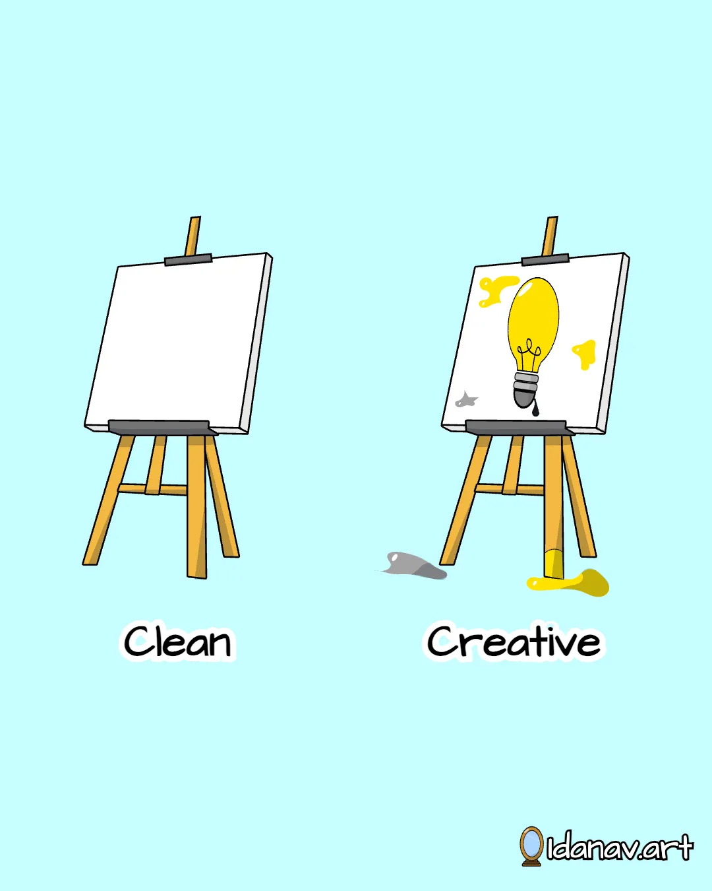
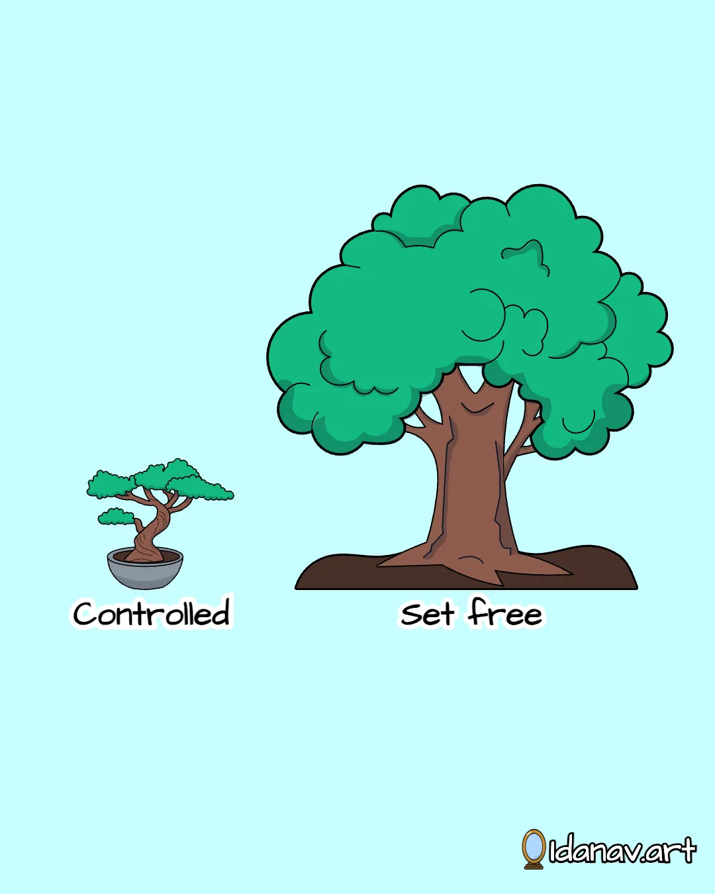
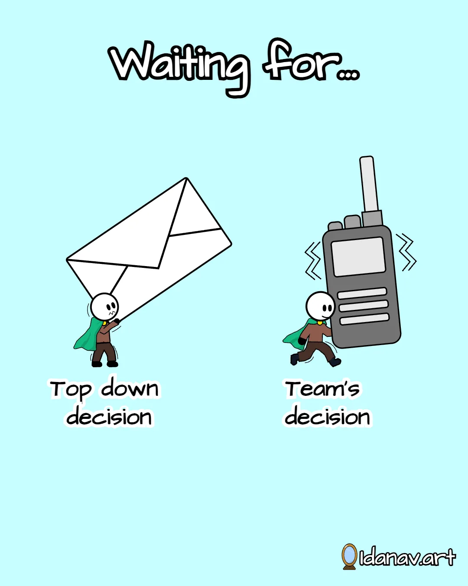

# Messy (Book)

## ✒️ Note-Making

### Clarify
🔈 *Summary of main ideas*
1. **Tidiness limits thinking** - Trying to limit ideas, our environment and the people around us to small, controllable and contained variables is like putting a limit to our capabilities. Tidiness is a form of restriction that blocks free flow of information, which is essential for anything that requires beyond the basic of skills. Any top down planning is doomed to mediocracy.
2. **Tidiness is costly** - Organization takes time, attention and space. Resources that can be spent elsewhere on being productive and creative.
3. **Improvement is messy** - We don't know in advance how the "best possible scenario" looks like, nor how to get there, so in order to be more skillful, more creative, you have to branch out, test out new ideas, fail and try again, even go at slightly random directions because it takes experimentation in order to land near optimum locations, careful slow incremental improvements won't get you there.
4. **Have outsiders** - When we pick teams of clones, with the same knowledge, same opinions, same echo chambers, we don't get better results, sometimes even worse. Having weak ties, diverse teams that offer ideas from different fields and perspective is key to unlocking better solutions.
5. **Flexibility is essential** - Tidiness is slow. Top down policies/rules gives more consistency in results at the price of low flexibility. It's a low risk low reward approach that provides little when the situation calls for custom, fast solutions. Being flexible doesn't just mean to be fast, it means to listen to the surface, to the people and their reaction and choosing the best fitting response, which can't be possible when we wait for high level, detached rules to give us a solution.
6. **Resilience requires complexity** - Tidiness usually means to have fewer interacting variables because complexity is messy, it's less predictable and controllable. But complexity leads to resilience. Complex systems have redundancy, richness and synergy that can't be created in small, controlled environment. From nature to economy and organizations, we should strive to have complex systems.
### Relate
⛓ *by following this method, what will happen? What is the goal of this book?*
By letting some mess into how we create, collaborate and organize, we give up a degree of control and consistency in exchange for better ideas, faster responses and more resilient systems. We won't get predictable results, but we will be less likely to settle for a local optimum.

### Act
📋*What should I do to achieve the goals set out by this book?*
1. **Explore before refining** - at the start of each new project, try several very different approaches, then make incremental improvements only on the most promising one, and go back to exploring if results disappoint (e.g., sketch 5 unrelated designs before polishing any).
2. **Create a shock when stuck** - whenever a project plateaus, impose a limitation that forces you to rethink it (e.g., drop your usual tool or method for one work session).
3. **Multitrack across fields** - keep a few projects from different fields running and each week move to whichever excites you most (e.g., switch from a writing project to a drawing one when motivation drops, letting the first problem run in the back burner).
4. **Reach out to weak ties** - once a month, talk to someone outside your immediate circle about a problem you're working on (e.g., a contact from a different field or department).
5. **Seek out dissent** - before each major decision, get input from someone who is likely to disagree, and align on the goal rather than on opinions (e.g., ask a colleague with an opposing view to rebut your plan).
6. **Listen, then improvise** - in your next few unscripted situations, respond to what is actually happening rather than following a prepared plan or policy (e.g., build on the other person's point with "yes, and" instead of returning to your script).
7. **Audit your metrics** - every quarter, check what behavior each metric incentivizes, then use a variety of metrics and rotate which ones you check (e.g., track several measures of a habit and review a different set each time).
8. **Practice what's automated** - once a week, do by hand something you normally leave to a tool, so your skills survive for when it fails (e.g., solve a small problem without the software, then compare results).
9. **Pile instead of filing** - for a month, stop categorizing incoming papers and keep them in a single pile, returning whatever you use to the top and periodically throwing out the bottom.
10. **Ask messy questions** - in at least one conversation a week, replace small talk with a question that invites a real answer (e.g., "when was the last time you got your heart broken?" instead of "how are you?").

### Critique

🧩 *relevant research, metaphors or examples that helps to convey the argument*
1. **Anecdote** – A musician created a fantastic show not despite but because of a half-broken piano. Supports: Constraints and disorder can push us beyond what a tidy setup would produce.
2. **Metaphor** – Hill climbing makes small improvements on a "good enough" design and can get stuck on a local optimum, while pure random movement may lead nowhere. Supports: Finding great solutions takes a mix of exploration and refinement.
3. **Case study** – Google, MIT and Pixar let workers control their environment, even adding or removing walls, while Jobs insisted only on spaces for "random encounters" at Pixar. Supports: Ownership and cross-organization collisions drive creativity and productivity.
4. **Example** – Jazz players record high-quality albums quickly through improvisation alone. Supports: Improvisation can match or beat preparation, because it responds to the situation as it is.
5. **Historical example** – Rommel's fast, unexpected movements broke past enemy lines with very few casualties, and Trump similarly created more headlines and fake news than other candidates could rebut. Supports: Speed and unpredictability create chaos that leaves opponents stuck in analysis.
6. **Case study** – Measuring doctors by the survival rates of their operations led them to avoid high-risk patients and over-perform surgeries on simple cases. Supports: Quantified targets create unintended incentives and can be gamed.
7. **Example** – A wrong facial detection could identify you as a terrorist and set off a chain of events that is very hard to stop, and even 99.9% accuracy still means one mistake in a thousand. Supports: Trusting automation blindly is dangerous, since we can't always tell when it has failed.
8. **Counter-intuitive example** – Replacing traffic lights with roundabouts shared with pedestrians saves lives, because drivers can no longer rely on the lights and have to stay aware. Supports: Friction and mess keep us attentive rather than on auto-pilot.
9. **Example** – Trying to eliminate supposedly harmful gut bacteria ignores how they interact with the rest, often causing imbalance. Supports: Top-down control removes the diversity that keeps a system stable, making controlled environments fragile.
10. **Example** – In a pile of papers, the important items stay on top because they get used, while the irrelevant sink to the bottom and eventually the trash, with no time spent organizing. Supports: Messy systems can outperform organized ones, whose classification is taxing because knowledge is a web, not a hierarchy.

❌ *the logical jumps, holes or simply cases where it is wrong...*
1. **Survivorship bias** - The evidence is mostly memorable successes, like the broken piano, Rommel and Pixar. We don't hear about the performances that flopped or the messy organizations that failed.
2. **False dichotomy** - The best examples depend on hidden order. Jazz improvisers rely on years of practice, and Jobs's "random encounters" were a top-down design decision. "Any top down planning is doomed to mediocrity" also conflicts with the book's own "mix of both".
3. **"Messy" is stretched too far** - It covers randomness, diversity, improvisation, complexity and friction. A term that broad gets credit for almost any success, which makes the thesis hard to falsify.
4. **Costs of mess are ignored** - Tidiness is charged an overhead tax, but the time lost searching and the attention lost to clutter aren't counted. A fair comparison needs both sides.
5. **Winning isn't the same as good** - Rommel and Trump show chaos working tactically, not that it's desirable or lasts. Rommel ultimately lost, and flooding the news with falsehoods is a harm the note treats as a tactic.
6. **Speed conflicts with listening** - One chapter calls being a *ponderer* a disadvantage, while another says listening takes real effort and adapting to the situation is what makes improvisation work.
7. **The metrics fix contradicts itself** - The note says more complex metrics aren't the solution, then proposes dozens of rotating ones. That is more complex, more costly, and may feel arbitrary to the people measured.
8. **Alternative explanation for roundabouts** - Lower speeds and fewer severe collision angles could explain the safety gains, without any heightened awareness. Roundabouts are also carefully engineered, so they're a weak example of mess.

🧱 *Implementations and limitations of it are...*
1. **Problem type** - It suits wicked, uncertain problems. Repeatable, high-stakes work, like surgery or aviation, benefits from standardization.
2. **Skill comes first** - Improvisation and exploration build on a foundation of competence. For a beginner, mess is just noise.
3. **It needs slack** - Random exploration and failed experiments cost time and money, which tight deadlines or budgets may not allow.
4. **Diversity needs management** - By the note's own account, it requires psychological safety and a shared goal, or it splits groups.
5. **Autonomy needs trust** - Empowered staff and self-designed workspaces need clear boundaries and accountability.
6. **Piles don't scale** - They work for one person and recent material. Shared or long-term information still needs a system, as your own vault shows.
7. **Mess works best in doses** - The practical version is a tidy core with deliberate mess at specific points, such as early exploration or a planned disruption.

### Review

💭 *my opinions on the book, the writers style...*
This is a nice book that goes against the idea of "tidiness" and order. Despite being a very orderly person, it's interesting to see how "messiness" can be so beneficial, and perhaps will cause me to let go of my controlling tendencies. While some of these ideas are not new, connecting them all under the umbrella of "messiness" is refreshing.

### Outline

## Notes

### Introduction

A musician able to create a fantastic show not despite, rather because they had a half broken piano.

We too often fall to the instinct of [Optimization](/notes/optimization-finds-the-efficient-point-balancing-outputs-and-inputs.md), we want a clean tidy life, with zero inboxes, clear KPIs, clean desk and going with the same "tried and true" method.

While in some areas it works, a clean unified strategy often lacks [Flexability](/notes/our-beliefs-must-adapt-as-context-and-goals-change.md). It's the [Randomness](/notes/deliberate-exposure-to-randomness-accelerates-ideation-and-discovery.md) that pushes us beyond our limits and help us create something special. Tidiness can only get you so far, it's messiness that helps you surpass it [Winner game](/notes/winner-take-all-games-reward-standing-out-over-following-best-practices.md)

### Creativity

There's in general two methods of improvements, especially relevant for [wicked](/notes/soft-vs-wicked-fields.md) problems where the best optimal result can't be found out by trying all possible combinations:
1. **Random movement** - to try random techniques, hoping to stumble on a great one.
2. **Hill climbing** - do small incremental improvements over a "good enough" design.

The problem with these two is that pure randomness might get us nowhere, and hill climbing can lead to local optimum, which are far from a global one.

Hill climbing is usually the default because it gives us a sense of control, a guarantee that we got "something", even if it's not great. The problem is that true innovation hardly comes from incremental improvements [Innovation comes from changing many dimensions at once, not from small incremental improvements](/notes/innovation-comes-from-changing-many-dimensions-at-once-not-from-small-incremental-improvements.md). Vast improvements only make sense if they're combining several changes together, so each on their own can't promise a better result, but together they can.

It takes a mix of both to get good results [Finding the best solution takes both exploring and refining](/notes/finding-the-best-solution-takes-both-exploring-and-refining.md). To get a sufficient sample of random guesses [exploration](/notes/deliberately-encountering-the-unfamiliar-drives-growth.md), and then to test out hill climbing in what shows promise. You might get back to exploration if the results are not satisfactory.

To get us out of the hill climbing mentality, we often need an external shock, some form of a [Limitation](/notes/lasting-change-requires-intensive-disruption.md) that forces us to reexamine the situation, to think hard and use our creative skills, and find the new local optimum, which could be a better one than before.

We're told that distractions are bad and that we should eliminate those, but distractions can be a source of [ideation](/notes/ideation-generates-ideas-through-exploratory-thinking-freed-from-constraints.md). This is because ideas from different fields can enrich whatever you're doing now, so having [Range](/notes/breadth-beats-depth.md) is very helpful for creativity.

In that sense, it's also better to [Multitrack](/notes/interconnected-knowledge-multiplies-creative-potential.md), especially across fields, since each can grant you insights for solutions for the other.

The benefits of jumping between projects is that we're always working on what excites us, maintaining motivation and avoiding boredom [Task switching incurs cognitive costs that reduce productivity](/notes/task-switching-incurs-cognitive-costs-that-reduce-productivity.md).

Another advantage is that while we're working on one thing, our [downtime brain](/notes/relaxation-activates-inward-thinking-for-creative-problem-solving.md) works on the first problem in the back burner.

Some use whiteboards, others cards, whichever method works to force you to think in different directions.

:::note[Creativity ^ref-65096]

- The combination of gradual improvements and random shocks turns out to be a very effective way to approach a host of difficult problems. ([Location 184](kindle://book?action=open&asin=B01BD1SU2E&location=184)) ^ref-31675
- Whether we’re trying to master a hobby, learn a language, write an essay, or build a business, it’s natural to want every change to be a change for the better. But like the problem-solving algorithms, it’s easy to get stuck if we insist that we will never go downhill. ([Location 208](kindle://book?action=open&asin=B01BD1SU2E&location=208)) ^ref-47612
- Messy disruptions will be most powerful when combined with creative skill. The disruption puts an artist, scientist, or engineer in unpromising territory—a deep valley rather than a familiar hilltop. But then expertise kicks in and finds ways to move upward again: ([Location 232](kindle://book?action=open&asin=B01BD1SU2E&location=232)) ^ref-55480
- Distractibility can indeed seem like an “issue,” or even a curse. But that’s if we’re looking only at the hill-climbing part of the creative process. Distractible brains can also be seen as brains that have an innate tendency to make those useful random leaps. ([Location 272](kindle://book?action=open&asin=B01BD1SU2E&location=272)) ^ref-11414
- creative ideas don’t always surrender to a frontal assault. Sometimes they sneak up on us while we are paying attention to something else. ([Location 426](kindle://book?action=open&asin=B01BD1SU2E&location=426)) ^ref-25901

:::

### Collaboration

A strong method of collaboration, despite common sense, is a method that uses [Weak Ties](/notes/weak-social-ties-bridge-different-networks-and-expand-access-to-opportunities.md). Our immediate environment shares the same knowledge and blindspots as we do, so when we venture out to more remote circles, we gain knowledge that we couldn't have had otherwise.

Such networking is essential since most of today's problems are very [Complex](/notes/complexity-makes-ideas-harder-to-understand-and-implement.md), so it's not likely for one person to be able to solve a problem end to end. Having a rich network of knowledge is essential [Complex problems require more diversity not less](/notes/complex-problems-require-more-diversity-not-less.md).

A good combination is having a team that forms a cluster for focused work, kinda like hill climbing, while also creating a network for knowledge sharing across teams, which is like the random leap.

The problem is that while [Diversity](/notes/diversity-of-perspectives-strengthens-decision-making-and-understanding.md) is very beneficial for decision making, it can also be either a diving factor [even arbitrary differences can split groups to the extremes](/notes/even-arbitrary-differences-can-split-groups-to-the-extremes.md), or lead to [Group Thinking](/notes/social-environment-shapes-behavior-and-identity-through-norms-and-conformity.md).

We have to maintain a diversity of opinions in our teams [Psychological safety](/notes/psychological-safety-enables-risk-taking-and-vulnerability-without-fear-of-retribution.md). Even if the conflicting voice is wrong or unhelpful, experiencing rebuttal causes us to think harder and more critically about our beliefs [people reflect and review their beliefs harder when they're challenged](/notes/people-reflect-and-review-their-beliefs-harder-when-theyre-challenged.md).

Despite all that, we still have a strong tendency to prefer people like us [Familiarity bias](/notes/we-prefer-what-is-familiar-over-what-is-better.md). We form [Echo chambers](/notes/conformation-bias-makes-us-accept-confirming-evidence-without-scrutiny.md) and feel a false sense of unity and being right, oblivious to other opinions.

A useful way of bridging the gap is to give them a "common enemy", to be united vs a common problem they need solving. An important alignment is not one of opinions, it's one of goals [Shared tactics unite people more than shared values](/notes/shared-tactics-unite-people-more-than-shared-values.md).

:::note[Collaboration ^ref-42606]

- vital ties are the weak ones. ([Location 575](kindle://book?action=open&asin=B01BD1SU2E&location=575)) ^ref-37507
- Most tasks require a combination of bonding and bridging: flashes of inspiration to identify the right approach, and long effort characterized by selfless teamwork to put it into practice. ([Location 614](kindle://book?action=open&asin=B01BD1SU2E&location=614)) ^ref-22336
- when dealing with a complicated problem, even the smartest person can get stuck. Adding a new perspective or a new set of skills can unstick us, even if the perspective is off-the-wall or the skills are mediocre. ([Location 748](kindle://book?action=open&asin=B01BD1SU2E&location=748)) ^ref-41027
- People think harder when they fear their views may be challenged by outsiders. ([Location 759](kindle://book?action=open&asin=B01BD1SU2E&location=759)) ^ref-26122
- When deliberating with a group, then, we should be seeking out people who think differently, who have different experiences and training, and who look different. Those people may bring fresh and useful ideas to the table; even if they do not, they’ll bring out the best in us—even ([Location 762](kindle://book?action=open&asin=B01BD1SU2E&location=762)) ^ref-42134
- when you give people an important enough problem to solve together, they can put aside their differences. A good problem contains the seeds of its own solution. ([Location 926](kindle://book?action=open&asin=B01BD1SU2E&location=926)) ^ref-25182

:::

### Workplaces

To make workers more collaborative and more productive, they need to have a sense of [Ownership](/notes/ownership-means-taking-active-responsibility-and-control-of-your-environment.md) over their workplaces. If each worker can design their space the way that fits for them, they will be more happy and productive.

Especially if the workplace promotes gathering of people from different departments, that's a strong contributor to creativity.

Despite all the benefits the ownership brings, it's not the common perception about office space. Still many organizations prefer a unified, clean space. That's because it *looks* productive and organised [pseudo productivity](/notes/pseudo-productivity.md). Mess seems like the anti-thesis of productivity, and it's an eye-sore as well.

Some workplaces like Google, MIT and Pixar have taken it to the extreme, letting workers control over their environment even to the point of removing or adding walls, redecorating entire rooms and working how they see fit. The only thing Jobs insisted on in Pixar was to create spaces for "random encounters", in order to create cross organization collision of ideas [watercooler effect](/notes/watercooler-effect.md). The rest is up to the worked.

:::note[Workplaces ^ref-51007]

- People flourish when they control their own space. ([Location 1265](kindle://book?action=open&asin=B01BD1SU2E&location=1265)) ^ref-33274

:::

### Improvisation

Being prepared is good, but preparation can only get you so far. Real life throws curve balls at you, which makes a "messy" improvisation a useful skill.

On a personal and organizational level, it provides flexibility, speed and economy of scale. It's much easier to react when you don't have to align with so many people, when you can treat the situation as it is instead of waiting for global, detached policies, and most importantly you listen, you adjust it the situation, which means your solution is much more effective and relevant [Informed autonomy leads to better decisions](/notes/informed-autonomy-leads-to-better-decisions.md).

From jazz players that record an album quickly and create high quality songs through just improvisation, to organizations that can have great customer support because they empower their employees to choose how to respond to any case.

Listening is not easy, it takes a lot of effort, but it is worth it [Active Listening](/notes/listening-well-requires-active-effort-to-understand.md). It allows you to match yourself to the energy of the situation [yes and](/notes/yes-and.md), you use their emotions in accordance with yours to create something powerful that resonates.

:::note[Improvisation ^ref-16537]

- the most important element in successful improvising is simply this: being willing to take risks and to let go. ([Location 1661](kindle://book?action=open&asin=B01BD1SU2E&location=1661)) ^ref-43901

:::

### Winning

In most competitive situations, you have to pay attention to your opponent, which means unpredictability and flexibility are key. What you do matters not just in terms of how it affects your position, but most importantly that of your opponent. Life is less like a sprint where each person is isolated from the rest, focusing just on their track. Life is more like chess, or war, where everyone acts at the same time with limited information [Winning depends on how you affect opponents](/notes/winning-depends-on-how-you-affect-opponents.md).

The greater speed and unpredictability you operate under, the more chaos and confusion created for the opponent, which often creates great opportunities to swift in and take the win. Rommel using fast and unexpected movements was able to quickly surpass enemy lines and win with very few casualties [speed creates opportunities in fast changing uncertain environments](/notes/speed-creates-opportunities-in-fast-changing-uncertain-environments.md). Same goes for Trump that created more headlines and fake news than other candidates could rebuttal.

Most people/organizations think first before they act, but being a *ponderer* is a disadvantage. Being quick of thought or quick to make a decision, you can constantly create chaos in the battlefield that will cause your opponents to be stuck in an analysis loop [Analysis paralysis](/notes/too-much-information-prevents-decision-making.md), unable to act. You can seize those opportunities and advance, changing the battlefield in your favor and controlling it.

It also helps to be small, and willing to take risks and loses in the short term for a better positioning/dominance in the long term. Being small means it's easier for you to maneuver and quickly change tactics [Small size enables fast adaptation](/notes/small-size-enables-fast-adaptation.md), and also less bounded by fixating beliefs of "this is how we've always done things" [Status-quo bias](/notes/we-prefer-existing-situations-over-alternatives-despite-better-options.md)

:::note[Winning ^ref-8188]

- success in a competitive situation isn’t just about what you do—it’s about the effect your actions have on your opponent. ([Location 1788](kindle://book?action=open&asin=B01BD1SU2E&location=1788)) ^ref-2693
- Chaos wasn’t just something that happened on the battlefield—it could and should be deliberately deployed as a weapon. ([Location 1994](kindle://book?action=open&asin=B01BD1SU2E&location=1994)) ^ref-22361

:::

### Incentives

Another problem with trying to make everything nice and tidy is to standardise results and best practices. When we start to measure things in a quantifiable way, they can have unintended results [When a measure becomes a target it loses accuracy](/notes/when-a-measure-becomes-a-target-it-loses-accuracy.md). For example measuring doctors based on the survival rates of their operations, caused doctors to avoid taking high risk patients and over perform surgeries on the simple cases.

We have to look at the [Incentives](/notes/incentives-shape-behavior-by-making-certain-actions-more-attractive.md) that our measurement policies generate.

It can cause us to have tunnel vision, to lie, to cheat and find twisted and complex ways to maximize the goal while actually hurting the bottom line. Making the metrics more complex is not a solution because there will always be loopholes to exploit.

Doesn't matter whether it's outcome based metrics or process based metrics. Anything can be gamed.

When we design metrics, especially heuristics we need to make sure we avoid [Overfitting](/notes/too-much-complexity-makes-models-worse-on-new-data.md).

The solution for a robust test systems that's mostly fail proof is having a variety of metrics, such that it will be impossible to game them all, and likely working on improving one will lead to a degradation in others, but overall bring a better service will be reflected in those metrics.

Also adding some randomness could be helpful. For example having dozens of metrics, but testing a different set each time, and/or in different intervals.

:::note[Incentives ^ref-1340]

- In each case, we assume that by measuring one thing, we’re really measuring everything. That is delusional. We hit the target, but miss the point. ([Location 2350](kindle://book?action=open&asin=B01BD1SU2E&location=2350)) ^ref-27332
- making targets more complex doesn’t stop their being gamed—it merely leads to their being gamed in more complex and unpredictable ways. ([Location 2433](kindle://book?action=open&asin=B01BD1SU2E&location=2433)) ^ref-61363
- The answer here is to split, as far as possible, the role of testing the system from the role of making the system better. ([Location 2564](kindle://book?action=open&asin=B01BD1SU2E&location=2564)) ^ref-20543

:::

### Automation

The *paradox of automation* is when automated processes hurt our skills [Automation erodes the skills it replaces](/notes/automation-erodes-the-skills-it-replaces.md) and potentially lead to harmful consequences by:
1. Reduce our "hands on" practice time by automating most of the work most of the time, so we're less experienced
2. **Fail at harder problems** - when automation fails, that's usually when something has gone horribly wrong, which requires above average skills to solve
3. **We lack context** - usually the systems that solve the issue, are also our information systems, so when they fail, we don't have any reliable information to lean on

It gets worse when we realize that we don't always know when the computer/algorithm/automation failed. For example a wrong facial detection might identify you as a terrorist, which will lead to a very bad chain of events, one that's very hard to stop and even more so to revert.

A computer program has perceived infallibility, even when it's wrong. And even a super reliable software will make a mistake eventually. A 99.9% accuracy still means that once in a thousand it will make a mistake.

Technology is becoming more and more our [Defaults](/notes/we-tend-to-accept-defaults-and-rarely-override-them.md), we trust it blindly to a fault. Our incompetence leads to a vicious cycle because since we're unable to verify whether the algorithm has made the right call, we have to rely on it even more for judgment.

A potential solution could be to [Invert](/notes/flipping-assumptions-reveals-hidden-possibilities-and-better-solutions.md) the responsibilities. Instead of computers doing everything and humans are forced to replace them in tricky situations, humans will do most of the work, and computers will be advisors when their input could be helpful or the situation is borderline risky.

Another option is to artificially surface small errors/messy situations to humans for them to solve in order to get them to practice their thinking skills in low risk stakes [Simulations](/notes/simulations-provide-safe-practice-environments-to-test-and-learn.md).

Messy situations are perhaps less enjoyable, because they force a certain level of [Friction](/notes/friction-keeps-us-attentive.md) to their environment which makes them be more attentive rather than acting on auto-pilot. For example, it might sound counter productive to replace traffic lights with roundabouts with pedestrians. But it's precisely this "messy" approach that saves lives because drivers can't become lazy anymore by relying on traffic lights for safety, rather they have to become constantly aware of their surroundings.

:::note[Automation ^ref-28997]

- The better the automatic systems, the more out-of-practice human operators will be, and the more unusual will be the situations they face. ([Location 2685](kindle://book?action=open&asin=B01BD1SU2E&location=2685)) ^ref-35341
- As people become more dependent on algorithms, their judgment may erode, making them depend even more on the algorithms. That process sets up a vicious cycle. ([Location 2846](kindle://book?action=open&asin=B01BD1SU2E&location=2846)) ^ref-25912
- Deprived of any awkward feedback, any modest challenges that might allow us to maintain our skills, when the crisis arrives we find ourselves lamentably unprepared. ([Location 2906](kindle://book?action=open&asin=B01BD1SU2E&location=2906)) ^ref-57184

:::

### Resilience

Our desire to make things tidy can come at a great cost. Usually making things tidy means reducing the amount of variance and diversity within the field we deal with in order to reduce the levels of complexity within the system.

For example, we might want to eliminate many of the bacteria in our guts that's supposably harmful, without taking to account how they interact with the rest of the bacteria, often causing imbalance. Same for our interventions in our natural environment [complexity](/notes/diversity-makes-complex-systems-resilient.md).

By being "top down planners" instead of observers, we at best ignore and at worst remove diversity which provides information and stability to the system as a whole. Controlled environment are fragile environments.

While specialization might be true at the level of the individual, it's the opposite for large scale organisms such as cities or countries. The diverse ones are more strong, capable, innovative and resilient. We need to find a way to eradicate our intolerance to strangers, as every society needs it's outsiders and diversity to flourish.

:::note[Resilience ^ref-11559]

- If you try to control a complex system, suppressing or tidying away the parts that seem unimportant, you are likely to discover that what seemed unimportant turns out to be very important indeed. ([Location 3102](kindle://book?action=open&asin=B01BD1SU2E&location=3102)) ^ref-56150
- Variety and sophistication go hand in hand. ([Location 3158](kindle://book?action=open&asin=B01BD1SU2E&location=3158)) ^ref-17417
- The economies that do lots of things tend to do most of those things very well. That is the road to prosperity—and in an unpredictable world, it is the road to resilience, too. ([Location 3173](kindle://book?action=open&asin=B01BD1SU2E&location=3173)) ^ref-10700
- every society needs its outsiders to bring new attitudes, ideas, and perspectives. ([Location 3367](kindle://book?action=open&asin=B01BD1SU2E&location=3367)) ^ref-55260

:::

### Life

We all want to be organized, have a clear calendar, to-do list and a clean desk, but is it productive. Tidiness can be it's own overhead tax [Organizing carries its own overhead](/notes/organizing-carries-its-own-overhead.md). Organizing things takes time, so the more things we have to organize, the more we spend time organizing them instead of doing them.

Another issue with organizing is that a clean classification hardly works both when we try to triage new information - for example do we categorize email by sender, priority, department, topic... and both when we try to locate the archived file - we need to remember how we categorized it at the time. The root cause is that knowledge is not hierarchical, it's a web of connected ideas, of many to many relationships that makes single tier classification difficult and taxing.

Organizing usually solves a problem that it creates. By clearing out our desk, we get rid of cues of what we needed to work on, which forces us to put those cues elsewhere, for example a todo list.

That's why surprisingly a "messy" system such as a pile of papers often wins. The most important thing is at the top, and usually gets back on the top when searched. The irrelevant find their way to the bottom of the pile, and eventually the trash. No time is spent organizing.

We also standardized human communication. From relying on dating algorithms, to preferring written text over real time communication, this tidyness drifts us apart [Standardized communication weakens connection](/notes/standardized-communication-weakens-connection.md). We listen less, we connect less.

A "messy" conversation is better. Asking questions such as "when was the last time you got your heart broken" is better than "how are you" [Open-ended questions enable deeper understanding and meaningful dialogue](/notes/open-ended-questions-enable-deeper-understanding-and-meaningful-dialogue.md).

Same goes with play. The more we protect and convert our playgrounds to safe and surveillanced locations, children experience less growth and fun. Giving them freedom to explore is what helps them grow [Free play builds capabilities better than early instruction](/notes/free-play-builds-capabilities-better-than-early-instruction.md). Which means also taking risks during play.

:::note[Life ^ref-8353]

- Our categories can map to practical real-world cases, or they can be neat and logical, but rarely both at once. ([Location 3435](kindle://book?action=open&asin=B01BD1SU2E&location=3435)) ^ref-18658
- much as we might wish otherwise, life takes place in real time. Life cannot be controlled. Life itself is messy. ([Location 3776](kindle://book?action=open&asin=B01BD1SU2E&location=3776)) ^ref-14468
- When we overprotect our children, denying them the opportunity to practice their own skills, learn to make wise and foolish choices, experience pain and loss, and generally make an almighty mess, we believe we’re treating them with love—but we may also be limiting their scope to become fully human. ([Location 3876](kindle://book?action=open&asin=B01BD1SU2E&location=3876)) ^ref-42945
- A good job, a good building, even a good relationship, is open and adaptable. ([Location 3889](kindle://book?action=open&asin=B01BD1SU2E&location=3889)) ^ref-29491

:::

